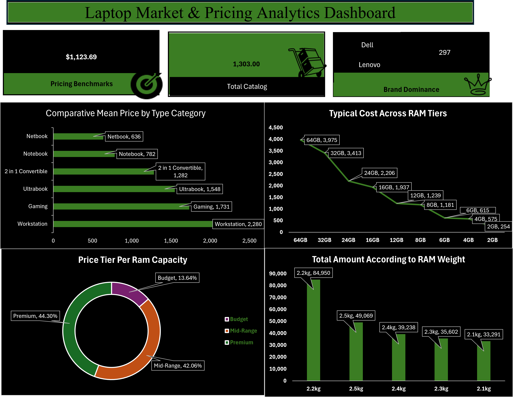

# Inside-the-Laptop-Economy

## Executive Summary
This project answers the question: What does it actually cost to own a laptop based on its brand? It does this by analyzing data to benchmark price tiers, compare the cost-per-weight, and establish the average price for different system types.

## Business Context
The consumer electronics market is driven by complex pricing dynamics where hardware specifications such as RAM capacity, form factor, and system weight significantly impact retail valuation. This project examines these market dynamics to uncover how manufacturers price performance tiers and how form factor tradeoffs influence end-consumer cost.

## 🎯 Project Objectives

* **Benchmark Average Cost per Hardware Spec:** Analyze pricing scaling across RAM tiers, tracing average market costs.
* **Assess Device Category Valuation:** Evaluate average pricing across form factors, benchmarking entry-level 
* **Evaluate Brand Dominance:** Measure catalog volume distribution across major manufacturers, evaluating top-tier brand presence.
* **Quantify Weight vs. Inventory Distribution:** Correlate system weight ($kg$) with catalog volume, isolating key physical weight segments
* **Determine Price Tier Share:** Segment overall inventory into distinct cost bands, measuring the distribution across **Budget (13.64%)**, **Mid-Range (42.06%)**, and **Premium (44.30%)** market tiers.

## Data Overview
This dataset analyzes a total of 1,303 laptop configurations across key hardware specifications, brand categories, and price tiers to evaluate retail market pricing dynamics.
  
## Data Preview
 

## Data Cleaning and Transformation
* Removed duplicate entries to ensure data integrity.
* Formatted the dataset into a structured table for efficient querying.
* Standardized text entries and applied consistent numerical formatting (including comma separators across all price amounts).
  
  
